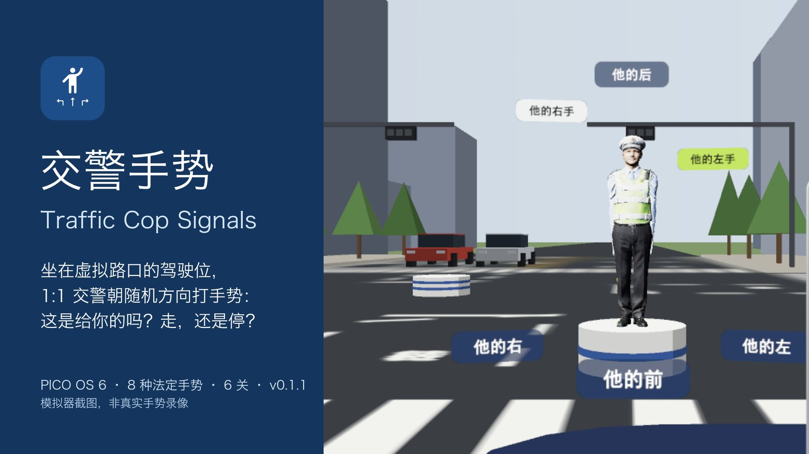
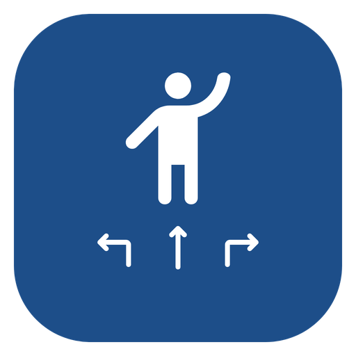
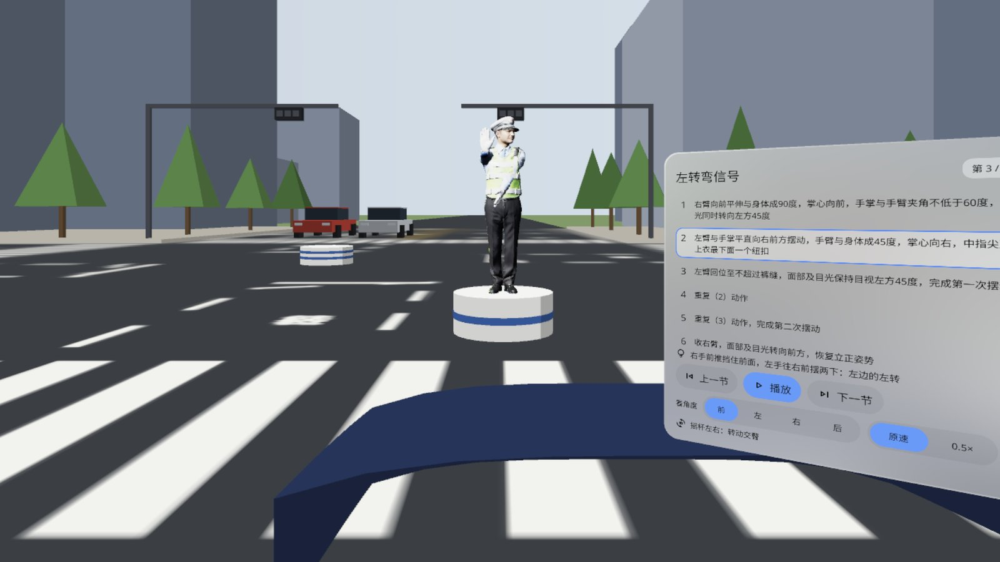
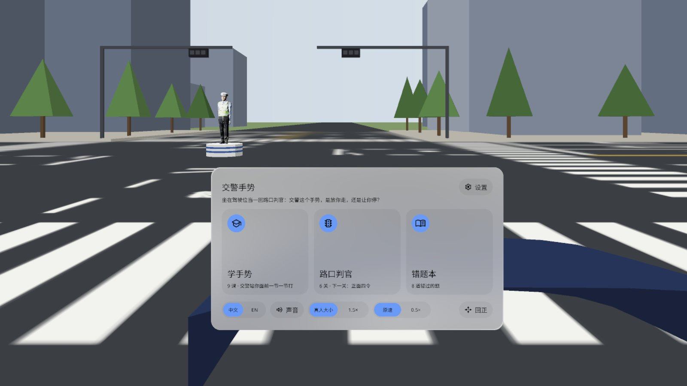
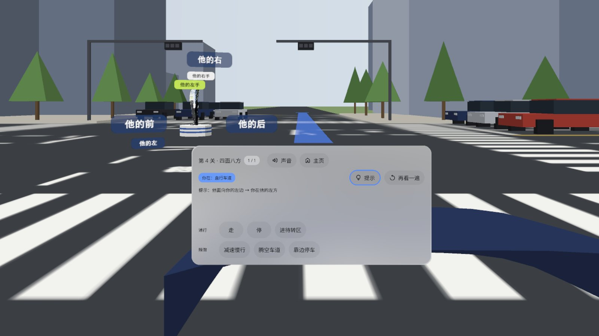
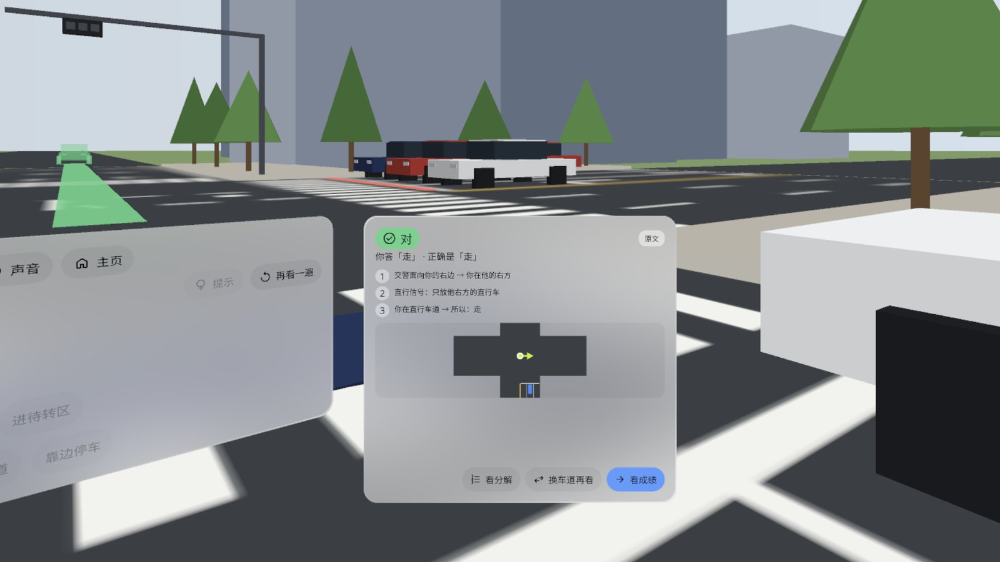
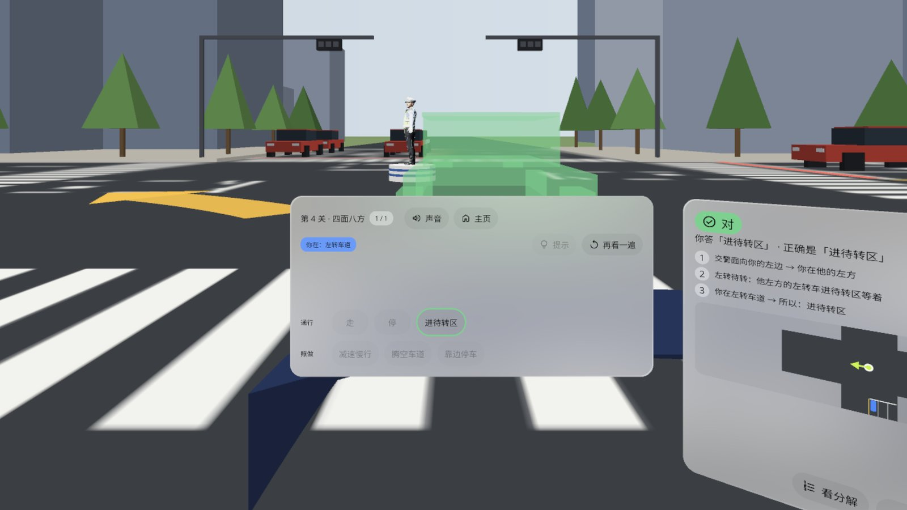
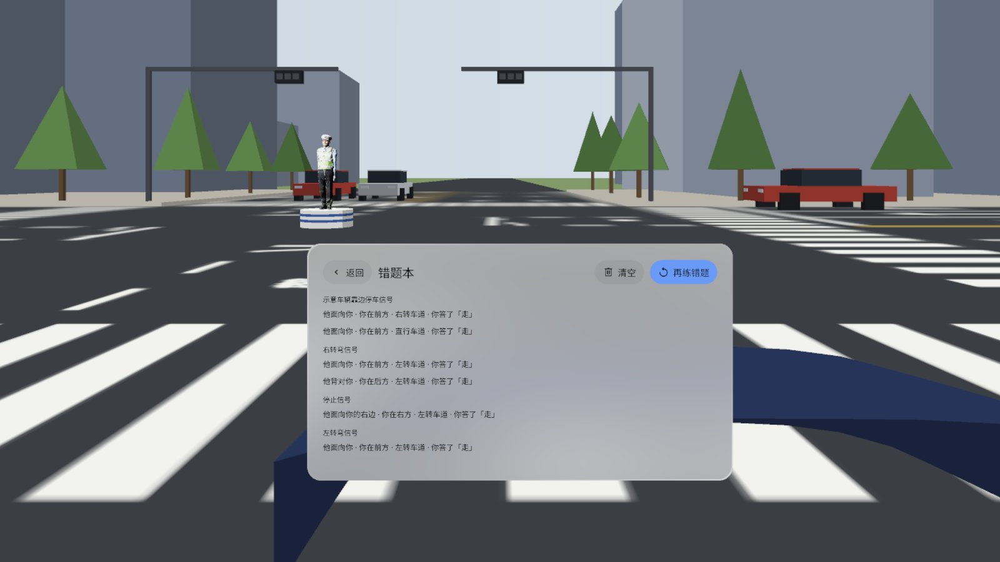

# Traffic Cop Signals 交警手势

> **v0.1.1 · Pre-release · passed emulator QA, not yet verified on a headset**（预发布 · 模拟器 QA 通过，真机未验证）





[English](#english) · [中文](#中文)

---

## English

Sit in the driver's seat at a virtual crossroads. A life-size traffic officer on the centre post turns to a random direction and gives one of the 8 official Chinese traffic police hand signals. Is that signal meant for your lane? Go, stop, pull into the waiting box, slow down, clear the lane or pull over. A PICO OS 6 app built with the PICO Spatial SDK.

- **Learn the signals**: 9 lessons. Lesson 0 teaches you to read his front, back, left and right; lessons 1–8 cover the 8 signals (stop, go straight, left turn, left turn wait, right turn, change lane, slow down, pull over). The officer demonstrates 6 m ahead, step by step, with the official wording of each step, four viewing angles, 0.5× speed and a thumbstick to turn him around
- **Crossroads judge**: 6 levels, 69 questions: Face to face · On his right · On his left · Any direction · Same signal, other lane · Timed judge (answer within 5 s). All levels are open from the start
- **Verdict card** explains every answer in three steps: which way he faces → whom the signal releases → which lane you are in. Right answers send your car off along its route, painted on the road ahead of you
- **[Hint]** stands small signs around the post ("his front / back / left / right")
- **Mistake book** groups wrong answers by signal and turns them into a practice round
- Settings: language (Chinese / English), sound, officer size (life-size or 1.5×), speed, re-centre the crossroads, reset progress, quit app
- Offline, no account, no permissions

### Screenshots (emulator, Chinese UI)

| | |
|---|---|
|  Learn: the left-turn signal frozen step by step, with the official wording on the right |  Home: learn, crossroads judge, mistake book; language, sound, 1.5× size and slow motion |
|  Read his position first: [Hint] stands "his front / back / left / right" signs around the post |  Verdict card: right, and why, in three steps |
|  Left turn wait: answer "pull into the waiting box" and your car slides over the zebra crossing into the box |  Mistake book: wrong answers grouped by signal, one tap to practise them again |

Screenshots come from the PICO emulator with states pinned by debug broadcasts. The side panels (verdict card at +36°, lesson panel at +30°) sit to your right, so a single forward screenshot only catches part of them; on QA's dedicated shots every panel shows all four rounded corners. The demo video in the release (`TrafficSignals-demo-1080p.mp4`, 58 s) is a native emulator run **driven by debug input — not a recording of real hand gestures or a real person** — and has no sound.

### Install

```bash
adb install -r TrafficSignals-v0.1.1.apk
pico-cli app launch io.embodit.trafficsignals
```

Get the APK from [Release v0.1.1](https://github.com/kejing-dev/TrafficSignals/releases/tag/v0.1.1). Requires PICO OS 6 (Spatial SDK 6.1.9, minSdk 35).

### Not yet verified on a headset

Emulator QA round 2 passed all three gates (no Material components; install + launch + 60 s with no crash / ANR; all 19 states captured and checked in Chinese and English) and confirmed all 7 round-1 findings fixed, including both blockers (the "ghost car" starting from your own seat and covering the panels; English level titles cut off). No headset was connected when this was published, so a person still needs to check on a real PICO:

1. Eye + pinch and controller ray + trigger on every button of P1–P4 and the dialog, especially the 6 answer keys, [Hint] and [Watch again] on P2's second row, and the three keys on P3 (the emulator cannot tap Stage panels).
2. Ghost car on all four routes (go straight / right / left, pull into the waiting box): no green car body in front of your face or the panels. The right-turn car comes closest (about 5.7 m) and passes behind P3; check it does not dazzle when you look at P3.
3. Readability of the officer's signals 14 m away: all 8 signals at life size and at 1.5×, each facing once (on the emulator he is about 20 px tall).
4. [Hint] direction signs: front and back are easy to tell apart in real depth and do not block the officer.
5. Settings → Quit app → Quit, by hand: the app leaves recents and reopens on a clean home screen.
6. Cold start once looking down 30° and once looking up 30°: P1 upright, facing you, near your line of sight.
7. P3 (+36°) and P4 (+30°): comfortable to turn to, buttons reachable.
8. Sound: 3 minutes with sound on is not annoying; mute is remembered.

### Known issues (non-blocking)

1. On the emulator the loading screen (S1) cannot be captured while the Stage builds its scene, so the S1 shot is from QA round 1 (v0.1.1 did not change it). Cold start to the home screen took 25–43 s on a loaded emulator host; the real timing needs a headset.
2. Screenshots are at the emulator's default 2160 × 2158, not High Definition 2560, cropped to 16:9.
3. Some lane / direction answers go beyond the official text and follow the rule "if you are not released, you wait" (e.g. a straight-ahead signal while you are in front of him). The verdict card marks each answer "Official" or "Inferred".
4. The officer model's licence follows the developer's Tripo account plan and has not been confirmed yet (see Credits). Confirm before making this repository public.

### Development

Kotlin · PICO Spatial SDK 6.1.9 · Full Space Stage (`STAGE_FULL`) with attachment panels P1–P4 and a dialog. See [AGENTS.md](AGENTS.md) for structure, the officer asset pipeline, debug broadcasts, the contrast gate and the QA screenshot list. Judging, levels and placement are plain Kotlin with JVM tests (`tools/dev.sh test`).

### Credits

- Traffic officer: generated by the developer in Tripo Studio (Tripo H3.1 image-to-3D from a reference image made with Nano Banana, then Tripo Auto Rig with a Mixamo-compatible skeleton). The 8 signals' 43 steps are posed and baked by `tools/officer/bake_officer.py` and checked against the official wording by `tools/officer/check_officer.py` (43 / 43). Use of the model follows the terms of the developer's Tripo plan, **not yet confirmed**; the raw GLB is not in this repository.
- Hand signals: the 8 traffic police hand signals of the Ministry of Public Security of China (in force since 2007); the step texts are quoted from the public regulation. Mnemonics, questions and explanations are original to this app.
- Fonts: Noto Sans / Noto Sans SC subset, SIL OFL 1.1 (`third_party/`).
- Icons: Material Symbols Rounded (`emoji_people`, `turn_left`, `straight`, `turn_right` and the UI glyphs), Apache-2.0.
- Streets, cars and buildings are built in code; sounds are synthesised in code.
- Panel pool, head tracker, theme and debug receiver are ported from the developer's Rehearsal Hall app; the thumbstick from Figure Model.

---

## 中文

坐在虚拟路口的驾驶位上，路口中心岗台上站着一位 1:1 的交警，他随机转向一个方向，打出 8 种法定交通警察手势中的一种。这个手势是给你这条车道的吗？该走、该停、进待转区、减速慢行、腾空车道，还是靠边停车？PICO OS 6 应用，PICO Spatial SDK 开发。

- **学手势**：9 课。第 0 课先认方位（他的前、后、左、右）；第 1–8 课是 8 种手势（停止、直行、左转弯、左转弯待转、右转弯、变道、减速慢行、示意车辆靠边停车）。交警在你前方 6 米示范，逐节定格，每节配公安部原文；可以换四个角度看、0.5× 慢放、用摇杆转动交警
- **路口判官**：6 关 69 题：正面四令 · 他的右边是你 · 他的左边是你 · 四面八方 · 换道再看 · 限时判官（5 秒内答）。一开始就全部能玩
- **判定卡**三步讲清为什么：他朝哪 → 这个手势放谁 → 你在哪条道。答对了，你的车沿着路面上画出的路线开出去
- **[提示]** 在岗台四周立起「他的前 / 后 / 左 / 右」小牌
- **错题本**按手势分组，一键再练
- 设置：语言（中 / 英）、声音、交警大小（真人 / 1.5×）、速度、路口回正、重置进度、退出应用
- 不联网，不需要账号，不申请权限

### 截图（模拟器，中文界面）

见上方截图表：

1. 学手势：左转弯信号一节一节定格，右边是公安部原文
2. 主页：学手势、路口判官、错题本，语言、声音、放大 1.5×、慢放都在这
3. 先认方位：[提示] 在岗台四周立起「他的前 / 后 / 左 / 右」小牌
4. 判定卡：答对了，三步讲清为什么
5. 左转待转：答「进待转区」，你的车从斑马线滑进待转框
6. 错题本：按手势分组记下答错的题，可以一键再练

截图来自 PICO 模拟器，状态用调试广播定住拍摄。判定卡（+36°）和课程面板（+30°）在你右手边，正前方的一张截图只拍到它们的一部分；QA 专项截图里每块面板四边圆角都完整。Release 里的演示视频（`TrafficSignals-demo-1080p.mp4`，58 秒）是原生模拟器演示，**由调试输入驱动，非真实手势录像**，无声。

### 安装

```bash
adb install -r TrafficSignals-v0.1.1.apk
pico-cli app launch io.embodit.trafficsignals
```

APK 在 [Release v0.1.1](https://github.com/kejing-dev/TrafficSignals/releases/tag/v0.1.1)。需要 PICO OS 6（Spatial SDK 6.1.9，minSdk 35）。

### 模拟器 QA 通过，真机未验证

模拟器 QA 第 2 轮三道门禁全过（无 Material 组件；装机、启动、60 秒无崩溃 / ANR；19 个状态中英截图全部核对），第 1 轮 7 条全部复核已修，包括两条阻断（「幽灵车」从你自己的座位出发、糊住视野并穿过面板；英文关卡名被截断）。发布时头显没连，下面这些要戴上头显人工看：

1. 眼手捏合、手柄射线 + 扳机点遍 P1–P4 和对话框的所有按钮，尤其 6 个答案键、P2 第二行的 [提示] [再看一遍]、P3 的三个键（模拟器点不到 Stage 面板）。
2. 幽灵车四条路线（直行 / 右转 / 左转答「走」、答「进待转区」）：脸前和面板前没有绿色车身。右转那辆离你最近（约 5.7 米），从 P3 后方经过，转头看 P3 时注意是否晃眼。
3. 14 米外交警手势看不看得清：真人大小和 1.5× 各看 8 个手势，四个朝向各一遍（模拟器里交警只有约 20 像素高）。
4. [提示] 方位立牌在真机景深下分得清前后、不挡交警。
5. 设置 → 退出应用 → 退出，用手点一遍：应用从最近任务消失，再开是干净的首页。
6. 低头 30°、抬头 30° 各冷启动一次：P1 竖直、正对你、在视线附近。
7. P3（+36°）、P4（+30°）转头看是否舒服、按钮点不点得到。
8. 声音：开着用 3 分钟不吵；静音开关记得住。

### 已知问题（不挡用）

1. 模拟器上 Stage 建场景期间截不到载入画面（S1），S1 截图沿用 QA 第 1 轮（v0.1.1 没改它）。负载高的模拟器上冷启动到首页要 25–43 秒，真实时长要真机看。
2. 截图是模拟器默认分辨率 2160 × 2158，不是高清 2560，裁成 16:9。
3. 部分车道 / 方位的答案超出公安部原文，按「没被放行就等」推断（例如你在他前方时看到直行信号）；判定卡上每题标「原文」或「规则推断」。
4. 交警模型的许可按开发者 Tripo 账号套餐条款，尚未核对（见致谢）；仓库公开前要先确认。

### 开发

Kotlin · PICO Spatial SDK 6.1.9 · Full Space Stage（`STAGE_FULL`）加 P1–P4 附着面板和对话框。结构、交警资源管线、调试广播、对比度门禁、QA 截图清单见 [AGENTS.md](AGENTS.md)。判题、关卡和摆放是纯 Kotlin，带 JVM 单测（`tools/dev.sh test`）。

### 致谢与许可

- 交警模型：开发者在 Tripo Studio 生成（Nano Banana 出参考图 → Tripo H3.1 图生 3D → Tripo Auto Rig，Mixamo 兼容骨架）。8 种手势 43 节由 `tools/officer/bake_officer.py` 摆姿势烘焙，`tools/officer/check_officer.py` 对公安部原文逐节核对（43 / 43）。模型使用按开发者 Tripo 套餐条款，**尚未核对**；原始 GLB 不在本仓库。
- 手势：公安部交通警察手势信号 8 种（2007 年起施行），每节文字引自公开法规原文；口诀、题目和解释为本应用原创。
- 字体：Noto Sans / Noto Sans SC 子集，SIL OFL 1.1（`third_party/`）。
- 图标：Material Symbols Rounded（`emoji_people`、`turn_left`、`straight`、`turn_right` 及界面图标），Apache-2.0。
- 街道、车辆、楼房由代码生成；声音全部由代码合成。
- 面板池、头部追踪、主题和调试接收器移植自开发者的 Rehearsal Hall，摇杆移植自 Figure Model。
