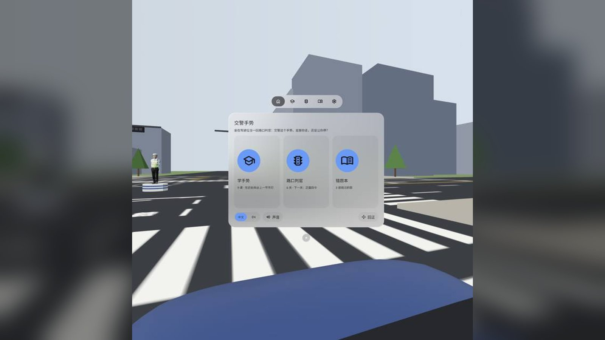
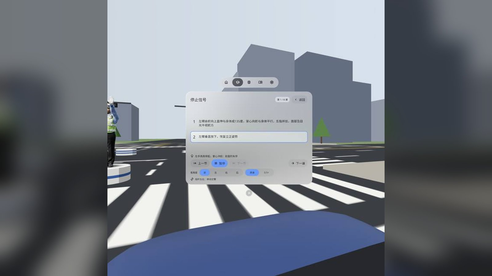
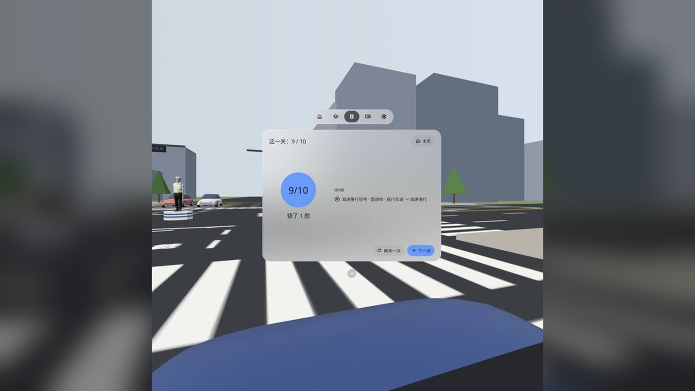
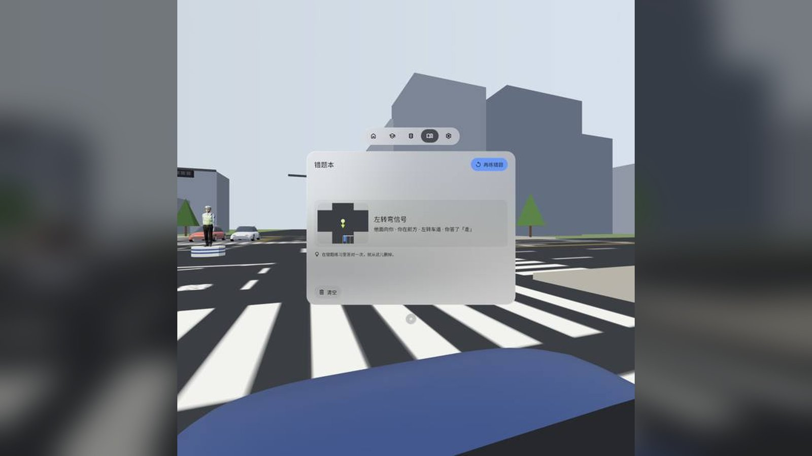
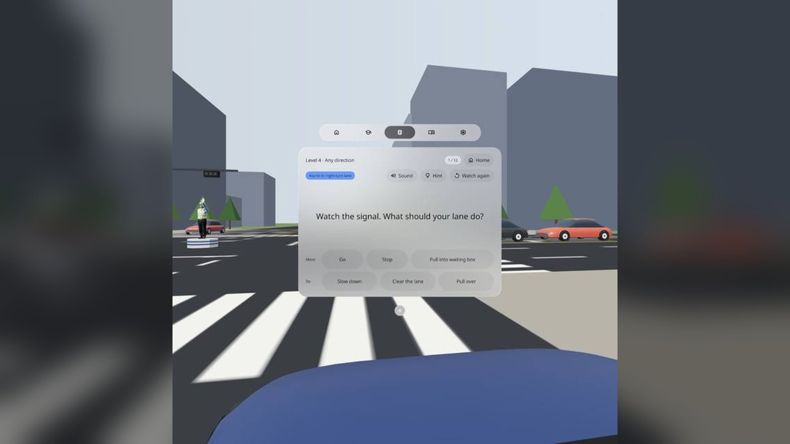
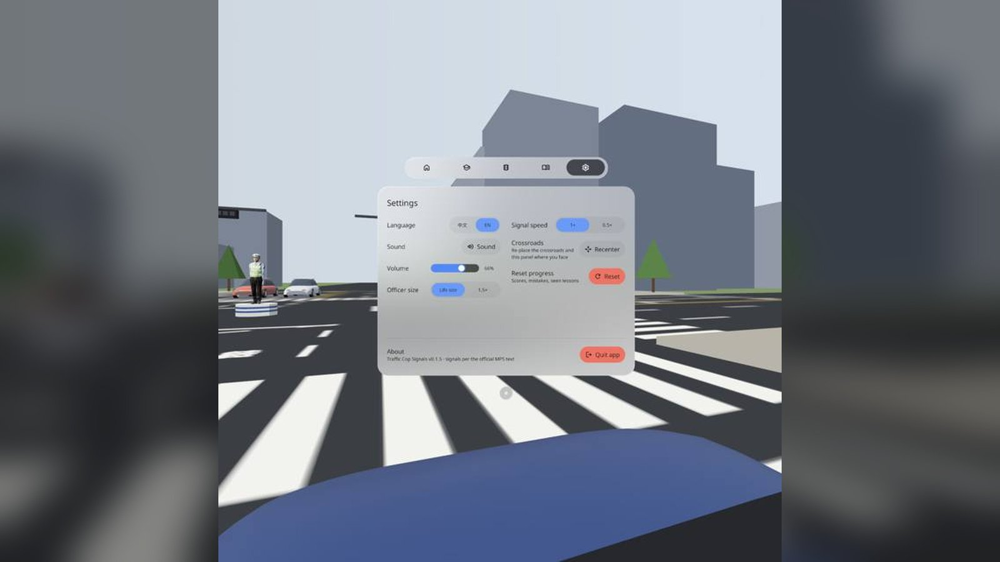

# Traffic Cop Signals 交警手势

> **v0.1.5 · checked on a PICO headset** · [Release v0.1.5](https://github.com/kejing-dev/TrafficSignals/releases/tag/v0.1.5)（真机看过，正式版）


[English](#english) · [中文](#中文)

---

## English

Sit in the driver's seat at a virtual crossroads. A life-size traffic officer on the post at the side of the junction turns to a random direction and gives one of the 8 official Chinese traffic police hand signals. Is that signal meant for your lane? Go, stop, pull into the waiting box, slow down, clear the lane or pull over. A PICO OS 6 app built with the PICO Spatial SDK.

- **Learn the signals**: 9 lessons. Lesson 0 teaches you to read his front, back, left and right; lessons 1–8 cover the 8 signals (stop, go straight, left turn, left turn wait, right turn, change lane, slow down, pull over). The officer demonstrates on the post ahead of you, step by step, with the official wording of each step, four viewing angles, 0.5× speed and a thumbstick to turn him around
- **Crossroads judge**: 6 levels, 69 questions: Face to face · On his right · On his left · Any direction · Same signal, other lane · Timed judge (answer within 5 s). All levels are open from the start
- **Verdict card** explains every answer in three steps: which way he faces → whom the signal releases → which lane you are in. Right answers send your car off along its route, painted on the road ahead of you
- **[Hint]** stands small signs around the post ("his front / back / left / right")
- **Mistake book** groups wrong answers by signal and turns them into a practice round
- Settings: language (Chinese / English), sound and volume, officer size (life-size or 1.5×), speed, re-centre the crossroads, reset progress, quit app
- Offline, no account, no permissions

### Screenshots (v0.1.5, emulator)

| | |
|---|---|
|  Start: the officer stands on the post at the left of the junction; the window is in front of you, your own bonnet below |  Home: learn, crossroads judge, mistake book; language, sound and re-centre along the bottom |
|  Lesson 1 "Stop": the officer demonstrates step by step, each step with the official wording |  Level 1 result 9/10: score on the left, the missed question and its right answer on the right |
|  Mistake book: wrong answers kept by signal, one tap to practise again |  Mistake drill intro: answer them again, right answers leave the book |
|  English UI: watch the signal, then pick what your lane should do |  English settings: language, sound, volume, officer size, speed, re-centre, reset, quit |

Screenshots are from the PICO emulator at QA round 6 (v0.1.5). They are rebuilt from the QA report's 640 px copies, so they are softer than the headset view. The QA demo video is a native emulator run **driven by adb taps — not a recording of real hand gestures** — and has no sound.

### Install

```bash
adb install -r TrafficSignals-v0.1.5.apk
pico-cli app launch io.embodit.trafficsignals
```

Get the APK from [Release v0.1.5](https://github.com/kejing-dev/TrafficSignals/releases/tag/v0.1.5). Requires PICO OS 6 (Spatial SDK 6.1.9, minSdk 35). The release APK is an unsigned `assembleRelease` build for store re-signing; to sideload it yourself, sign it with your own debug key first (`apksigner sign --ks ~/.android/debug.keystore …`) or build `./gradlew assembleDebug`.

### What changed since v0.1.1

- **v0.1.2** One native window: all 2D content in one system window with the SpatialUI TabBar (home / learn / judge / mistakes / settings). The officer starts on the post at the left of the junction instead of on top of you; city image-based lighting so his shirt and skin are no longer washed out.
- **v0.1.3** Timed level: pausing, the leave dialog or closing the window stops the signal and the 5 s clock and never reveals the answer; volume slider; a rounded bonnet with mirrors for your own car and rounded cars on the road.
- **v0.1.4** [Again] after a drill that cleared the mistake book replays the round; taller volume slider; [Clear] on the mistake book asks first; system minimise stops the clock like closing the window.
- **v0.1.5** Result, mistake book, intro, confirm and short lesson pages re-laid out without large empty bands; bigger question line and answer keys.

### Verification

- Emulator QA round 6 (v0.1.5) passed all gates: no Material components; install + launch + 60 s with no crash / ANR; 58 Chinese and English screenshots; real taps through the main flow to Quit; 68 / 68 buttons respond in each language, no text overflow logged.
- The developer installed v0.1.5 on a PICO headset (Swan) and approved it for release on 2026-11-10.

### Known issues (non-blocking)

1. **English results page, 5 or more questions**: each row is limited to one line, so the end of "gesture · facing · lane → correct answer" is cut off with an ellipsis (`Panels.kt` result list, `maxLines = 1` when there are more than 4 rows). Chinese fits. Not fixed in this release.
2. A few pages still have an empty band of 20–24 % of the window between title and content (results 1/1, mistake book with 1 row, question page, settings); all under the 25 % limit.
3. On the emulator the loading screen (S1) cannot be captured while the Stage builds its scene.
4. Some lane / direction answers go beyond the official text and follow the rule "if you are not released, you wait"; the verdict card marks each answer "Official" or "Inferred".
5. The officer model's licence follows the developer's Tripo account plan and has not been confirmed yet (see Credits).

### Development

Kotlin · PICO Spatial SDK 6.1.9 · Full Space Stage (`STAGE_FULL`) with one system Planar window and the native TabBar for all 2D UI. See [AGENTS.md](AGENTS.md) for structure, the officer asset pipeline, debug broadcasts, the contrast gate and the QA screenshot list. Judging, levels and placement are plain Kotlin with JVM tests (`tools/dev.sh test`).

### Credits

- Traffic officer: generated by the developer in Tripo Studio (Tripo H3.1 image-to-3D from a reference image made with Nano Banana, then Tripo Auto Rig with a Mixamo-compatible skeleton). The 8 signals' 43 steps are posed and baked by `tools/officer/bake_officer.py` and checked against the official wording by `tools/officer/check_officer.py` (43 / 43). Use of the model follows the terms of the developer's Tripo plan, **not yet confirmed**; the raw GLB is not in this repository.
- Hand signals: the 8 traffic police hand signals of the Ministry of Public Security of China (in force since 2007); the step texts are quoted from the public regulation. Mnemonics, questions and explanations are original to this app.
- Fonts: Noto Sans / Noto Sans SC subset, SIL OFL 1.1 (`third_party/`).
- Icons: Material Symbols Rounded (`emoji_people`, `turn_left`, `straight`, `turn_right` and the UI glyphs), Apache-2.0.
- Streets, cars and buildings are built in code; sounds are synthesised in code.
- Panel pool, head tracker, theme and debug receiver are ported from the developer's Rehearsal Hall app; the thumbstick from Figure Model.

---

## 中文

坐在虚拟路口的驾驶位上，路口岗台上站着一位 1:1 的交警，他随机转向一个方向，打出 8 种法定交通警察手势中的一种。这个手势是给你这条车道的吗？该走、该停、进待转区、减速慢行、腾空车道，还是靠边停车？PICO OS 6 应用，PICO Spatial SDK 开发。

- **学手势**：9 课。第 0 课先认方位（他的前、后、左、右）；第 1–8 课是 8 种手势（停止、直行、左转弯、左转弯待转、右转弯、变道、减速慢行、示意车辆靠边停车）。交警在你前方岗台示范，逐节定格，每节配公安部原文；可以换四个角度看、0.5× 慢放、用摇杆转动交警
- **路口判官**：6 关 69 题：正面四令 · 他的右边是你 · 他的左边是你 · 四面八方 · 换道再看 · 限时判官（5 秒内答）。一开始就全部能玩
- **判定卡**三步讲清为什么：他朝哪 → 这个手势放谁 → 你在哪条道。答对了，你的车沿着路面上画出的路线开出去
- **[提示]** 在岗台四周立起「他的前 / 后 / 左 / 右」小牌
- **错题本**按手势分组，一键再练
- 设置：语言（中 / 英）、声音和音量、交警大小（真人 / 1.5×）、速度、路口回正、重置进度、退出应用
- 不联网，不需要账号，不申请权限

### 截图（v0.1.5，模拟器）

见上方截图表：

1. 开场：交警站在路口左侧岗台上，主窗口在你前方，底下是你自己的车头
2. 主页：学手势、路口判官、错题本三张卡，底栏切中英、声音、回正
3. 学手势第 1 课「停止」：交警逐节示范，每节配公安部原文
4. 路口判官第 1 关 9/10：左边大圆是分数，右边列出答错的题和正确答案
5. 错题本：答错的题按手势记下，一键再练
6. 错题练习说明：再答一遍，答对就从错题本删掉
7. 英文界面答题页、英文设置页

截图来自 QA 第 6 轮（v0.1.5）的 PICO 模拟器，用 QA 报告里 640 px 的副本合成，比头显里看到的糊一些。QA 演示视频是原生模拟器演示，**由 adb 点按驱动，非真实手势录像**，无声。

### 安装

```bash
adb install -r TrafficSignals-v0.1.5.apk
pico-cli app launch io.embodit.trafficsignals
```

APK 在 [Release v0.1.5](https://github.com/kejing-dev/TrafficSignals/releases/tag/v0.1.5)。需要 PICO OS 6（Spatial SDK 6.1.9，minSdk 35）。Release 里的 APK 是 `assembleRelease` 未签名包，给商店流水线重签名用；自己侧载要先用自己的 debug key 签名（`apksigner sign --ks ~/.android/debug.keystore …`），或者 `./gradlew assembleDebug` 自己出包。

### v0.1.1 之后改了什么

- **v0.1.2** 一个原生窗口：2D 内容都在一个系统窗口里，用 SpatialUI 原生 TabBar 切主页 / 学手势 / 路口判官 / 错题本 / 设置。交警开场站在路口左侧岗台上，不再落在你身上；换成城市环境光，衬衫和肤色不再发白。
- **v0.1.3** 第 6 关限时：暂停、离开确认、关窗时手势和 5 秒钟一起停，不露答案；加音量滑条；自己的车换成圆弧车头 + 后视镜，路上配角车换成圆角车身。
- **v0.1.4** 练到错题清空后 [再来一次] 重练本局；音量滑条加高；错题本 [清空] 先确认；系统最小化和关窗一样停表。
- **v0.1.5** 结果页、错题本、说明页、确认框、短课重新排版，不再留大片空白；答题页提问句和答案键放大。

### 验证

- 模拟器 QA 第 6 轮（v0.1.5）门禁全过：无 Material 组件；装机、启动、60 秒无崩溃 / ANR；中英 58 张截图；真实点按主流程走到退出；中英各 68 / 68 个键有响应，无文字溢出日志。
- 开发者 2026-11-10 在 PICO 头显（Swan）上装了 v0.1.5，看过后放行发布。

### 已知问题（不挡用）

1. **英文结果页 5 题以上**：每行限一行，「手势 · 朝向 · 车道 → 正确答案」末尾会被省略号截掉（`Panels.kt` 结果列表，超过 4 行时 `maxLines = 1`）。中文放得下。本版不修。
2. 少数页面标题和内容之间还有占窗高 20–24% 的空带（结果 1/1、错题本 1 条、答题页、设置页），都在 25% 线以内。
3. 模拟器上 Stage 建场景期间截不到载入画面（S1）。
4. 部分车道 / 方位的答案超出公安部原文，按「没被放行就等」推断；判定卡上每题标「原文」或「规则推断」。
5. 交警模型的许可按开发者 Tripo 账号套餐条款，尚未核对（见致谢）。

### 开发

Kotlin · PICO Spatial SDK 6.1.9 · Full Space Stage（`STAGE_FULL`）加一个系统 Planar 窗口和原生 TabBar，2D 内容都在窗口里。结构、交警资源管线、调试广播、对比度门禁、QA 截图清单见 [AGENTS.md](AGENTS.md)。判题、关卡和摆放是纯 Kotlin，带 JVM 单测（`tools/dev.sh test`）。

### 致谢与许可

- 交警模型：开发者在 Tripo Studio 生成（Nano Banana 出参考图 → Tripo H3.1 图生 3D → Tripo Auto Rig，Mixamo 兼容骨架）。8 种手势 43 节由 `tools/officer/bake_officer.py` 摆姿势烘焙，`tools/officer/check_officer.py` 对公安部原文逐节核对（43 / 43）。模型使用按开发者 Tripo 套餐条款，**尚未核对**；原始 GLB 不在本仓库。
- 手势：公安部交通警察手势信号 8 种（2007 年起施行），每节文字引自公开法规原文；口诀、题目和解释为本应用原创。
- 字体：Noto Sans / Noto Sans SC 子集，SIL OFL 1.1（`third_party/`）。
- 图标：Material Symbols Rounded（`emoji_people`、`turn_left`、`straight`、`turn_right` 及界面图标），Apache-2.0。
- 街道、车辆、楼房由代码生成；声音全部由代码合成。
- 面板池、头部追踪、主题和调试接收器移植自开发者的 Rehearsal Hall，摇杆移植自 Figure Model。
